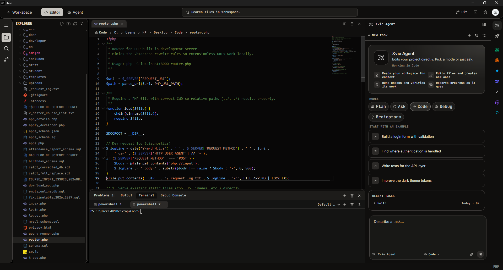
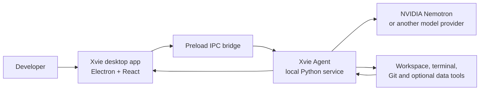

<div align="center">

# Xvie

### Your coding workspace, with an AI agent in the loop.

Edit code, run commands, review Git changes, and work with an AI coding agent from one Windows desktop app.



*The Xvie editor with its project explorer, terminal, and agent panel open.*

</div>

## What is Xvie?

Xvie is an AI-assisted development environment for working on local codebases. It combines a desktop IDE with an agent that can inspect a project, plan a task, use development tools, and help implement changes. A local Python service connects the desktop app to model providers and coordinates the agent's multi-step work.

The goal is to keep the everyday coding loop together: open a project, ask a question or request a change, inspect the proposed work, and continue in the editor, terminal, or Git view.

## Highlights

- **Code workspace:** Browse project files and edit them in the Monaco editor.
- **AI coding agent:** Ask for explanations, plans, debugging help, and code changes. The agent can use workspace tools and run approved actions, then use tool results to continue its response.
- **NVIDIA Nemotron:** The project configuration uses NVIDIA Nemotron 3.5 Lightning as its default agent model. The agent can use it for task understanding, planning, coding, and tool-driven follow-up turns.
- **Provider choice:** Select NVIDIA or a detected local Meterless/Nightshift runtime in Agent settings. Other OpenAI-compatible providers can be configured too.
- **Developer tools:** Use the integrated terminal, Git workflows, project history, and workspace utilities.
- **Browser Agent:** Optionally work with supported web chat services through a dedicated browser profile.
- **Zetaris:** Optionally discover data sources and run read-only SQL queries through the agent.

## NVIDIA Nemotron in Xvie

NVIDIA Nemotron is the primary model family configured for Xvie's coding agent. The example configuration selects `nvidia/nemotron-3.5-lightning-30b-a3b` through NVIDIA's OpenAI-compatible API. In Xvie, that model powers the agent's normal request loop: interpreting a task, deciding when to inspect or change files, calling available tools, and responding with the results.

Nemotron 3.5 Lightning is a 30-billion-parameter model with 3 billion active parameters, using a hybrid Mixture-of-Experts architecture. NVIDIA describes it as suited to agentic workflows and coding. Xvie uses the API endpoint and model ID; this repository does not bundle model weights. Read the [official NVIDIA model card](https://build.nvidia.com/nvidia/nemotron-3.5-lightning-30b-a3b/modelcard) for the model details and terms.

To enable NVIDIA, add a valid API key to `Backend/xvie-agent/.env` or enter the provider details under **Agent → Model providers**:

```dotenv
FORGE_PROVIDER_NVIDIA_API_KEY=your-nvidia-api-key
FORGE_PROVIDER_NVIDIA_BASE_URL=https://integrate.api.nvidia.com/v1
FORGE_DEFAULT_PROVIDER=nvidia
DEFAULT_MODEL=nvidia/nemotron-3.5-lightning-30b-a3b
```

Provider selection and model ID can be changed in the app. Without valid provider credentials or a reachable local runtime, model requests cannot complete.

## How the pieces fit together



The desktop app starts its local coding-agent service when needed. The service runs on loopback and uses a per-launch bearer token for requests from the app. The agent can call tools over multiple turns, so it can incorporate command or file results before replying. Changes that need approval follow the app's review flow.

## Quick demo

1. Open a project in Xvie.
2. Open Agent settings and select **NVIDIA** (Nemotron) or **Meterless** if the local runtime is running.
3. Ask the agent to explain an unfamiliar file or outline a plan for a small improvement.
4. Review the plan, approve changes when prompted, then inspect the result in the editor and Git view.
5. Use the integrated terminal to run the project's own checks.

## Getting started

### Requirements

- Windows 10 or 11 (the commands below use PowerShell).
- Node.js and npm.
- Python 3.11 or newer.
- Git for Git features.

### Install the desktop app

Run from the repository root:

```powershell
cd Frontend
npm install
```

### Set up the coding agent

In a new PowerShell terminal at the repository root:

```powershell
cd Backend/xvie-agent
py -3.11 -m venv .venv
.venv\Scripts\python.exe -m pip install -e .
Copy-Item .env.example .env
```

Add a valid model-provider credential in `Backend/xvie-agent/.env`, or configure a provider from the app's settings. The example values are placeholders. `.env` files are ignored by Git; keep real credentials out of tracked files. Xvie starts the coding-agent sidecar when it is needed.

### Run Xvie

From the repository root:

```powershell
cd Frontend
npm run dev
```

Build the Electron app's production bundles with:

```powershell
cd Frontend
npm run build
```

## Model providers

### NVIDIA Nemotron

Configure `FORGE_PROVIDER_NVIDIA_API_KEY` and `FORGE_PROVIDER_NVIDIA_BASE_URL`, then select NVIDIA in **Agent → Model providers**. The default model ID in `.env.example` is `nvidia/nemotron-3.5-lightning-30b-a3b`. You can enter a different compatible model ID in provider settings.

### Meterless / Nightshift

When the local runtime is running, Xvie looks for its bearer token at `%LOCALAPPDATA%\ai.meterless.runtime\proxy-token` and adds a **Meterless** provider profile. The defaults are `http://127.0.0.1:8088/v1` and model `worker`. Start the local runtime before choosing Meterless. The token remains in the runtime's local file. Optional overrides are `METERLESS_TOKEN_PATH`, `METERLESS_BASE_URL`, and `METERLESS_MODEL` in the agent process environment.

### Other OpenAI-compatible providers

Add a `FORGE_PROVIDER_<NAME>_API_KEY` and `FORGE_PROVIDER_<NAME>_BASE_URL` pair in the agent's `.env`, or add the provider through Agent settings. Saved keys use Electron `safeStorage` where available.

## Optional integrations

### Browser Agent

The Browser Agent is a separate Python sidecar that supports selected browser-based chat sites through its own Chrome profile. Install its dependencies and browser from the repository root:

```powershell
cd Backend/browser-agent
py -3.11 -m venv .venv
.venv\Scripts\python.exe -m pip install -r requirements.txt
.venv\Scripts\python.exe -m playwright install chromium
```

The desktop app starts the sidecar when a browser feature needs it. Sign in to the supported sites in the Browser panel's dedicated window on first use.

### Zetaris

Zetaris is an optional read-only data connection. Configure `ZETARIS_BASE_URL`, `ZETARIS_USERNAME`, and `ZETARIS_PASSWORD` in `Backend/xvie-agent/.env`. The agent can discover registered data sources, tables, and columns, and run read-only SQL. The datasource must already be configured and reachable from Zetaris. If Zetaris is unavailable, the core coding flow remains usable.

## Checks

From `Frontend`:

```powershell
npm run typecheck
npm test
```

From `Backend/xvie-agent`:

```powershell
.venv\Scripts\python.exe -m pytest
```

## Project structure

```text
Frontend/                 Electron main/preload code and React application
Backend/xvie-agent/       Python coding agent and local service
Backend/browser-agent/    Optional Python Browser Agent sidecar
Icons/                    Application icons
docs/screenshots/         README screenshots
TECH_STACK.md             Frontend technology notes
```

See the [Xvie Agent guide](Backend/xvie-agent/README.md), [Browser Agent guide](Backend/browser-agent/README.md), and [technology notes](TECH_STACK.md) for more detail.

## Local data and credentials

- Provider keys entered in Agent settings are encrypted with Electron `safeStorage` where supported by the operating system.
- Keep credentials in ignored `.env` files or the app's secure provider settings; never commit real keys.
- Agent conversations and state are saved in `.xvie-sessions` inside the selected workspace.
- Browser Agent sign-ins use its separate local browser profile.
